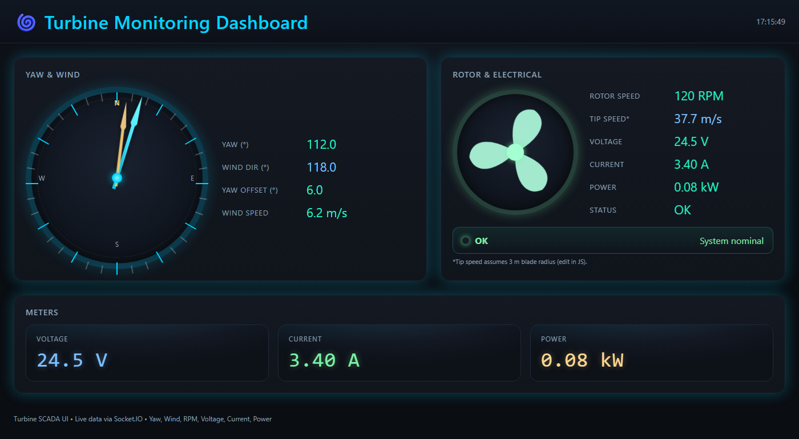
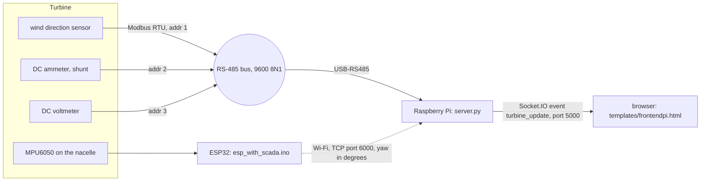

# Wind turbine SCADA dashboard

Telemetry and a live web dashboard for a 1 kW wind turbine, built for **ASU Wind** (Ain Shams University) between August and November 2025. A Raspberry Pi polls the turbine's sensors and meters over Modbus RTU (RS-485) and serves a Socket.IO dashboard on the local network. An ESP32 measures the nacelle's yaw.

**Team:** Abdelrahman Sherif (SCADA + instrumentation) and Ahmad ([LinkedIn](https://www.linkedin.com/in/ahmad-alkalea/)). The two of us did all the work in this repository.


*Dashboard rendered with sample values.* The desk demo of the running system is in [media/scada-desk-demo.mp4](media/scada-desk-demo.mp4).

## Architecture



## What we did

- **Sensor reverse engineering:** the wind speed and direction sensors came without usable documentation. We traced their PCB wiring, found pins swapped against the datasheet, and found their Modbus addresses by brute-force scanning with Modbus Poll.
- **Electrical measurement:** voltage and current sensing (current through a shunt) with Modbus DC meters on a shared RS-485 bus.
- **Software:** the Python Modbus poller and Socket.IO server on the Raspberry Pi, the web dashboard (compass for yaw and wind, rotor animation, meters, status bar), and the ESP32 yaw sensor.

## Modbus register map (as used in `server.py`)

| Device | Address | Register | Format | Dashboard field |
|---|---|---|---|---|
| Wind direction sensor | 1 | `0x0000` | 16-bit | `wind_dir` (°) |
| DC ammeter | 2 | `0x4000` | signed 32-bit, big-endian (ABCD), mA → A | `amp` |
| DC voltmeter | 3 | `0x0000` | 16-bit, 2 decimals | `volt` |

All devices share one bus at 9600 baud, 8N1. The server reads every device once per second. If a device does not answer, its field is sent as `--` and the status changes to `FAULT`.

## Current limits

- **Yaw and rotor speed** are fixed placeholder values in `server.py` (`yaw = 155.0`, `rpm = 1500.0`). They are not measured yet.
- **Wind speed** is not read (sent as `--`).
- The ESP32 sends yaw to the Pi on TCP port 6000, but the Pi-side receiver and the later Kalman-filter version of the yaw estimate (done with my teammate) are not in this repository.

## ESP32 yaw sensor (`esp_with_scada/`)

The ESP32 reads the MPU6050 gyroscope's Z axis. At start-up it averages 2000 samples to remove the gyro bias. It then low-pass filters the rate, integrates it into a yaw angle wrapped to ±180°, and sends the angle to the Raspberry Pi over Wi-Fi every 100 ms.

## Run

On the Raspberry Pi, with the USB-RS485 adapter connected:

```bash
pip install -r requirements.txt
cp .env.example .env            # then edit; or export the variables
export $(grep -v '^#' .env | xargs)
python server.py                # dashboard at http://<pi-address>:5000
```

ESP32: copy `esp_with_scada/secrets.example.h` to `secrets.h` (it is git-ignored) and fill in your Wi-Fi details and the Pi's address. Then build the sketch with the Arduino IDE (ESP32 board package and an MPU6050 library).

## Repository layout

```
server.py                     Modbus poller + Socket.IO server (Raspberry Pi), final version
templates/frontendpi.html     web dashboard
esp_with_scada/               ESP32 + MPU6050 yaw sensor (secrets in secrets.h, not committed)
legacy/                       earlier server versions, kept to show how the design evolved:
                              single-meter test server, multi-device and 32-bit read versions,
                              server3.py (voltage + current), first dashboard package
docs/dashboard.png            dashboard screenshot (sample values)
media/scada-desk-demo.mp4     desk demo video
requirements.txt, .env.example
```

The legacy servers use the earlier meter addresses and placeholder registers. They are not maintained.

## License

MIT. See [LICENSE](LICENSE). The sensor and meter manuals used during the project belong to their manufacturers and are not included.
